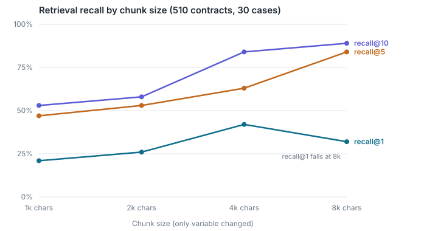

# rag-eval-harness

Measure whether a change to a RAG system actually helped — and if it didn't, say which
part broke.

---

## The problem

Picture a law firm with 510 contracts in a filing room, and a junior assistant who
answers questions about them. *Which law governs the Acme supply agreement? Is there a
cap on liability in the Siemens deal?*

The assistant can't read 510 contracts for every question. So a runner goes to the
filing room first, pulls out the five pages that look relevant, and drops them on the
desk. The assistant reads those five pages and writes the answer.

That pair is a RAG system. The runner is **retrieval**; the assistant is
**generation**. Everything else is plumbing.

Now you want it to work better. Let the runner bring ten pages instead of five. Cut the
files into smaller pieces so each page is more focused. Train the runner to understand
what questions *mean* rather than matching words. Hire a cleverer assistant.

**How do you know if any of that helped?**

Usually you don't. You ask three questions you happen to think of, read the answers,
and form an impression — and that impression misses what actually happened: simple
lookups improved slightly, while questions needing two different parts of a contract
got much worse. The net effect looks like nothing changed.

This tool is the exam that finds out.

## The idea it's built around

When an answer is wrong, there are exactly two culprits. Either the runner fetched the
wrong pages and the assistant never stood a chance — or the right page was on the desk
and the assistant misread it.

Those need opposite fixes. **And a single accuracy score cannot tell them apart.**

So this harness never reports one number. It marks retrieval and generation separately,
which it can do because the answer key records not just the correct answer but *which
passage of which document it lives in*. A failing case comes back as either:

> Retrieved pages 3, 7, 12 — the answer was on page 9.

which is a retrieval problem, or:

> Retrieved page 9 — answered "no cap is specified".

which is a generation problem. One tells you to change chunk size or search method. The
other tells you to change the prompt or the model. Guessing between them is how weeks
get spent tuning the wrong half.

## What else it insists on

**The examiner gets examined.** Judging a written answer needs judgment, so a model
does the marking. That model can be wrong, which would make every number it produces
fiction. So its verdicts are checked against a human's on a sample, and the agreement
rate is published. Numbers from an unchecked judge are not evidence.

**A difference has to beat the noise.** Run the same evaluation twice and the score
moves, because models don't repeat themselves exactly. If configuration A scores 71%
and B scores 73%, that gap might be real or might be Tuesday. You have to know how much
the score wobbles on its own before a two-point difference means anything.

**Errors are never hidden in the denominator.** A case that fails is recorded as an
error with its reason, and error counts sit next to scores — so "90% accurate" can
never quietly mean "90% of the cases that didn't crash".

**Refusing is a correct answer.** Two-thirds of the test set asks about clauses that
genuinely aren't in the contract. The right response is "that isn't in there", and
getting it wrong is the failure that matters most in production.

**Every number traces back.** Each run records the dataset fingerprint, the exact
configuration, the models, which upstream provider served each call, the cost, and the
code version. A result you can't trace to its inputs isn't a result.

---

## Status

**Phase 5 of 14.** Honest account of what exists:

| | |
|---|---|
| Corpus — 510 contracts, ingested, fingerprinted, verifiable | ✅ |
| Test set — 30 cases with expert-annotated answer locations | ✅ |
| Chunking and keyword retrieval | ✅ |
| Model layer — caching, spend cap, retries, provider pinning | ✅ |
| Vector search, answer generation, the judge | ⬜ next |
| Judge calibration, noise handling, A/B reports | ⬜ |

Everything marked ✅ runs with **no API key and no cost**, and the test suite is
enforced to stay that way.

## Try it

Requires [uv](https://docs.astral.sh/uv/). In GitHub Codespaces the devcontainer
installs it and syncs dependencies for you, so you can skip straight to `uv run pytest`.

```bash
uv sync --dev
uv run pytest                            # 119 tests, no credentials involved
uv run python -m rag_eval ingest         # fetch and normalise CUAD (~18 MB)
uv run python -m rag_eval verify         # prove it hasn't changed since
uv run python -m rag_eval build-testset  # select 30 cases from 20,910 candidates
```

To use models, one [OpenRouter](https://openrouter.ai/keys) key covers everything. In
Codespaces, add it as a Codespace secret named `OPENROUTER_API_KEY` rather than writing
a file — it is then present as an environment variable and never touches the disk.
Elsewhere:

```bash
cp .env.example .env                        # paste your key; .env is git-ignored
uv run python -m rag_eval models --search llama   # real prices, read from the gateway
uv run python -m rag_eval check-models            # two calls, a fraction of a rupee
```

## A result it has already produced

Varying **only** chunk size, everything else fixed, measuring how often retrieval finds
the passage containing the answer:



| Chunk size | Chunks | recall@1 | recall@5 | recall@10 |
|---|---|---|---|---|
| 1,000 chars | 30,578 | 21% | 47% | 53% |
| 2,000 chars | 15,444 | 26% | 53% | 58% |
| 4,000 chars | 7,834 | **42%** | 63% | 84% |
| 8,000 chars | 4,012 | 32% | **84%** | 89% |

Note that recall@1 peaks at 4,000 characters and *falls* at 8,000, while recall@10 keeps
climbing. A bigger chunk is more likely to contain the answer but dilutes the signal
that ranks it first — so the best chunk size depends on how many passages you intend to
show the model. That is not obvious in advance, and choosing a chunk size by intuition
would get it wrong.

## The mistake worth reading about

The first end-to-end retrieval run scored **zero out of nineteen**.

Not weak retrieval — a design fault. Questions named their contract using a name derived
from the filing identifier, which squashes the company into a single token
(`lejuholdingsltd`) that appears nowhere in the corpus. The one word capable of
identifying the right document matched nothing, so search returned plausible-looking
passages from arbitrary contracts.

The fix was to name contracts using words that provably appear inside them, taken from
the corpus's own expert annotations. Recall went from 0% to 53%.

It is in this README because the risk had been written down when the corpus was chosen,
three phases earlier — *"if every configuration scores near zero, the corpus or the
question generation needs revisiting"* — and it surfaced exactly where predicted, at the
first honest end-to-end run. Had generation been built first, every number downstream
would have been zero and the cause three phases behind.

## How it's built

Python, with `uv` for dependencies. Configuration in YAML, validated on load so a
mistyped field fails loudly instead of silently falling back to a default. Retrieval is
exact search over a NumPy array rather than a vector database, deliberately: approximate
search varies between index builds, and a harness whose entire claim is *"this changed
because that changed"* cannot afford an index that moves underneath it.

Every model call goes through one module, so switching models is a configuration line.
That module caches by a key covering everything that can change an answer, enforces a
hard spending limit, counts retries rather than hiding them, and pins the upstream
provider — because a gateway that silently reroutes would make every comparison
unattributable.

## Documentation

| | |
|---|---|
| [`docs/ROADMAP.md`](docs/ROADMAP.md) | Phases, current step, fixed constraints |
| [`docs/DECISIONS.md`](docs/DECISIONS.md) | Every choice, its alternatives, its risks, and how we'd notice it was wrong |
| [`docs/ARCHITECTURE.md`](docs/ARCHITECTURE.md) | Components, data flow, module map |
| [`docs/FAILURE_MAP.md`](docs/FAILURE_MAP.md) | If X breaks, look here |
| [`docs/EVAL_METHODOLOGY.md`](docs/EVAL_METHODOLOGY.md) | What each metric measures, and what it cannot |

`DECISIONS.md` is the one worth reading. Every entry records what was chosen, what was
rejected and why, what could go wrong because of the choice, and how we would find out.

## Data and licence

The corpus is the [Contract Understanding Atticus Dataset](https://www.atticusprojectai.org/cuad),
510 commercial contracts annotated by legal experts, licensed CC BY 4.0. It is fetched
by script and verified against a recorded fingerprint; no corpus files are committed.
