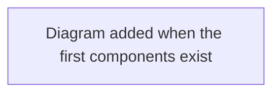

# Architecture

How the harness is put together: what each component owns, how data moves through it,
and what it depends on from outside.

**Status:** empty. Nothing is built. This document gets its first real content in the
phase that builds the reference pipeline and run harness; until then the sections below
are placeholders so that nothing is filled in speculatively.

---

## 1. Components and responsibilities

_TBD._ One row per component. A component's responsibility is stated as what it owns
and, where useful, what it explicitly does not own.

| Component | Owns | Does not own | Lives in |
|-----------|------|--------------|----------|
| _(none yet)_ | | | |

---

## 2. End-to-end data flow

_TBD._ Narrative walkthrough of a single evaluation run, from config file to report,
naming the artefact produced at each hop (config → manifest → per-case records →
aggregates → report).

---

## 3. Diagram

_TBD._ Mermaid diagram of the run path, kept in sync with section 2.

---

## 4. Module map

_TBD._ Directory tree annotated with what lives where, so a file can be located from a
symptom without searching.

---

## 5. External dependencies

_TBD._ Everything we rely on that we do not control, with why we depend on it and what
breaks if it is unavailable or changes.

| Dependency | Used for | Version pinned? | If it fails |
|------------|----------|-----------------|-------------|
| _(none yet)_ | | | |
